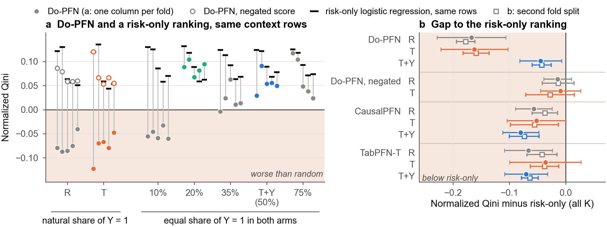

# Перепроверка анализа и план улучшения статьи

10 ноября 2026. До дедлайна WSDM 7 дней: 17 ноября 23:59 AoE = 18 ноября 14:59 МСК.

Всё ниже получено на CPU из сохранённых предсказаний и записей прогонов. Новых прогонов на GPU и DataSphere не было,
текст статьи не менялся, в GitHub и Overleaf ничего не отправлялось. Числа — средние по пяти фолдам, в квадратных
скобках 95% t-интервалы по фолдам, как в статье. Источник каждого числа — [recheck_summary.txt](recheck_summary.txt),
технические детали — [README.md](README.md). Раздел 3.6 написан по текстам статей авторов моделей.

## 0. Коротко

1. **Главный факт устоял.** На Criteo Do-PFN с контекстом естественного состава ранжирует хуже случайного: Q̂ около
   −0.08 в 5 фолдах из 5, при каждом K от 512 до 4096, на двух разных разбиениях на фолды и на отложенной выборке в
   2.09 млн строк (−0.046).
2. **«Дешёвый ремонт» не устоял.** Логистическая регрессия исхода по признакам, обученная на тех же строках контекста
   и не видящая столбец воздействия, даёт Q̂ 0.08–0.10. T+Y (+0.051) ниже неё на 0.045 [0.007, 0.082]. Оценка Do-PFN
   из естественного контекста, умноженная на −1, даёт +0.074: сопоставимо с T+Y (разность +0.023 [−0.006, +0.053]).
3. **Что на самом деле выдаёт Do-PFN на Criteo:** ранжирование по базовому риску со знаком, который данные контекста
   не определяют. Знак задаётся знаком предсказанного среднего эффекта (правило выполняется в 178 прогонах из 180), а
   этот средний эффект в естественных контекстах неверного знака в 100% прогонов и в 17 раз больше истинного.
4. **Лучший план:** сменить жанр с «диагноз + ремонт» на аудит («ранжирование по риску с произвольным знаком и
   проверки без разметки») и добавить один решающий эксперимент: перестановку меток групп воздействия. В пилоте
   перестановка 0↔1 перевернула знак эффекта в двух контекстах из двух.
5. **Цена.** Tier 0: правки текста и таблицы из уже посчитанного, без новых прогонов. Tier 1: не больше 18 GPU-часов
   на DataSphere (со всеми контролями 23; это оценка сверху), 3–4 часа реального времени на семи T4. Узкое место —
   текст и иллюстрации, а не счёт.
6. **Новизна проверена по первоисточникам.** Авторы Do-PFN не проверяли модель ни на настоящем рандомизированном
   эксперименте, ни на бинарном исходе. У CausalPFN есть своя uplift-таблица с Criteo, но при контексте около 40 тыс.
   строк и без опорной линии риска: на неё нужно сослаться и назвать разницу (раздел 3.6).

## 1. Что перепроверено и как

- Все числа статьи по CV и отложенной выборке пересчитаны из построчных предсказаний: 3 900 CV-прогонов (пять
  датасетов, три модели) и 38 контекстов на отложенной выборке Criteo.
- Для Criteo и LZD в `repro/home` лежит полный набор прогонов на **другом** разбиении на фолды (scikit-learn 1.5.2
  делит иначе, чем 1.8.0). Это бесплатная репликация, в статье она не использована.
- Заголовочные числа пересчитаны вторым скриптом, который не использует код первого. Расхождений нет.
- 15 контекстов на дизайн делят пять оценочных выборок (одна на фолд), поэтому все утверждения даны по фолдам.
- Три маленьких CPU-прогона Do-PFN на отдельных контекстах. Это пилоты, а не эксперименты.
- Проверен порядок строк в файле Criteo (он не перемешан).

## 2. Что подтвердилось

| Утверждение статьи | Перепроверка | Итог |
|---|---|---|
| Инверсия при естественном составе, K=1024: T −0.077 | Фолды статьи: R −0.074, T −0.077, отрицательно в 5 фолдах из 5. Второе разбиение, все K: R −0.088, T −0.073, тоже 5 из 5 | Подтверждено и реплицировано |
| Размер контекста не лечит (−0.072…−0.085) | Фолды статьи: R −0.074…−0.083, T −0.072…−0.085. Второе разбиение: −0.052…−0.094 | Подтверждено |
| Отложенная выборка: −0.046 → +0.048 | Воспроизведено | Подтверждено |
| CausalPFN и TabPFN-T не инвертируют | +0.02…+0.05 во всех дизайнах | Подтверждено, но оба на 0.04–0.08 ниже ранжирования по риску |
| 20% лучше T+Y на отложенной выборке (0.074 против 0.049) | Воспроизведено | Подтверждено, но 20% лишь равняется с ранжированием по риску (0.075) |
| LZD как второй датасет | Те же знаки, R отрицателен в 5 фолдах из 5 на обоих разбиениях, но Q̂(μ̂0) = 0.021 при SD 0.041 по оценочным выборкам | Слабое свидетельство: всё внутри шума |

## 3. Что в нынешнем тексте уязвимо

По убыванию опасности.

**3.1. Рамка «cheap repair»** (аннотация, вклад во введении, правило (1) в Discussion). Criteo, все K, фолды статьи:

| Ранжирование | Q̂ | Разность с риском на тех же строках |
|---|---|---|
| Логистическая регрессия исхода, те же строки контекста, без столбца воздействия | 0.083–0.095 | — |
| Do-PFN, R | −0.079 | −0.167 [−0.229, −0.106] |
| Do-PFN, T | −0.079 | −0.162 [−0.222, −0.103] |
| Do-PFN, T+Y («ремонт») | +0.051 | −0.045 [−0.082, −0.007] |
| Do-PFN, R, оценка × (−1) | +0.074 | −0.015 [−0.039, +0.010] |
| Do-PFN, T, оценка × (−1) | +0.074 | −0.009 [−0.045, +0.026] |
| CausalPFN, R / T / T+Y | +0.032 / +0.031 / +0.015 | −0.057 / −0.052 / −0.080 |
| TabPFN-T, R / T / T+Y | +0.022 / +0.047 / +0.025 | −0.066 / −0.036 / −0.070 |

На втором разбиении картина та же (T+Y −0.043 [−0.060, −0.026]). На отложенной выборке: T+Y 0.048 против 0.077 у
риска (ниже во всех 3 контекстах; на подвыборке 200 тыс. строк — в 10 из 10), 20% — 0.074 против 0.075 (ниже в 5 из
10, то есть ничья). T+Y проигрывает модели, которая ничего не знает о воздействии, и не лучше простой смены знака.
Рецензент, который добавит эту опорную линию, снимет главный практический вывод статьи за десять минут.

**3.2. Предложение в RQ2** (`paper/main.tex`, строка 124): «A context without information about who responds would
give Q̂ near zero… Learners fitted on the same rows do give near zero». На тех же строках модель риска даёт 0.08–0.10.
Информация о том, кто даёт вклад в Qini на Criteo, в контексте есть, и это базовый риск. Около нуля оказываются
именно uplift-модели на 1024 строках, потому что они оценивают шумную разность.

**3.3. «A plain risk score does as well»** (строка 151) сравнивает только с моделью на 2 млн строк. Сравнивать нужно
с моделью на тех же 1024 строках.

**3.4. Порядок строк Criteo.** Файл не перемешан: 12 смен группы на 13.98 млн строк. Проверено, что на результаты это
не влияет: оценочные и отложенные выборки равномерны по файлу, воздействие по признакам не предсказывается (AUC
0.505). Но подпись к рис. 3 говорит «ties are split by row order». Нужно правило для совпадающих значений, не
зависящее от порядка, и одна фраза о проверке.

**3.5. Вопросы, которые задаст рецензент:** «это только Criteo?» и «корректно ли применять регрессионную PFN к
редкому бинарному исходу?». Сейчас ответ — одна оговорка про документированный режим. Нужны положительный контроль и
манипуляция (см. Tier 1).

**3.6. Позиционирование среди смежных работ** (проверено 10.11 по текстам статей на arXiv; числа перед вставкой в
статью сверить с PDF).

- **Do-PFN** (arXiv 2506.06039v3). Авторы оценивали модель только на синтетике, RealCause и двух наблюдательных
  наборах с симулированными исходами, метрика — нормированная MSE. Нет ни одного настоящего рандомизированного
  эксперимента, бинарного исхода, Qini или AUUC; проверку на реальных данных они сами называют ограничением.
  Предобучение шло на таблицах до 2 200 строк: наши K от 512 до 2 048 лежат внутри этого диапазона, 4 096 — вне, а
  инверсия одинакова при всех K. Работ, оценивающих Do-PFN на uplift-данных, поиск не нашёл: результат новый.
- **CausalPFN** (arXiv 2506.07918, NeurIPS 2025). В статье есть собственная uplift-таблица, и Criteo в ней есть.
  Наша статья цитирует CausalPFN во введении и в описании моделей, но эту таблицу не упоминает. Отличия: у авторов
  контекст около 40 тыс. строк (подвыборка 50 тыс., 80% в контекст; лимит поднят с 4 096 до 50 000), у нас не больше
  4 096; их Qini нормирован на лучшую модель столбца (у CausalPFN на Criteo 0.859, лучший — X-learner), без
  интервалов и повторов; опорной линии «только риск» нет ни в одной их таблице. Что делать: сослаться, прямо назвать
  разницу в размере контекста, не делать выводов о CausalPFN на 40 тыс. строк. Отсутствие линии риска в таблице самих
  авторов модели — довод в пользу C4.
- **Работы 2026 года.** Stith, Rahmani, Cresswell, «Causal Foundation Models» (arXiv 2609.03003): на RealCause-Lalonde
  относительная ошибка ATE у Do-PFN 0.88–0.89, авторы читают это как систематическое сжатие эффекта к нулю. Это
  согласуется с нашими Hillstrom (0.42 истинного размера) и Orange (0.07); знак и ранжирование там не разбираются.
  Panagopoulos (arXiv 2605.10430): ранги оценщиков с полусинтетических бенчмарков не переносятся на реальные данные
  (среди пяти реальных наборов есть Criteo и Hillstrom); PFN там нет. Mourao и др. (arXiv 2603.15928): смещение и
  низкое покрытие интервалов у CausalPFN в клинических симуляциях. Melnychuk и др., 2026, о смещении, наведённом
  приором: известна мне только по ссылке в 2609.03003, ближе всего к C3, прочитать до пятницы.

## 4. Что выяснилось нового

**4.1. Это ранжирование по риску с обратным знаком.** Если оставить от оценки Do-PFN только порядок десяти страт по
базовому риску, получается Q̂ −0.100 (R) и −0.097 (T) при полном −0.079; у T+Y +0.058 при полном +0.051. Ранговая
корреляция оценки с риском: −0.74 (R), −0.60 (T), +0.03 (T+Y).

**4.2. Знак задаёт предсказанный средний эффект, а он не привязан к контексту.** Правило «знак корреляции с риском =
знак среднего τ̂ × знак (0.5 − доля положительных в контексте)» выполняется в 178 из 180 прогонов Do-PFN на Criteo и в
169 из 180 на LZD. В естественных контекстах Criteo (240 прогонов на двух разбиениях) предсказанный средний эффект
равен −0.183 при разности средних в самом контексте +0.010; знак неверен в 100% прогонов; медианное расстояние до
контраста контекста — 12.6 стандартной ошибки; у 4.5% строк |τ̂| > 1 при исходе 0/1 (максимум 75.5). У CausalPFN и
TabPFN-T за пределами 2 SE 4.2% и 1.2% прогонов, и ни одной строки вне [−1, 1].

Важная оговорка: сам контекст знак среднего эффекта определить не может (SE разности средних при K=1024 равна 0.0145
при истинном эффекте 0.010). Ошибка Do-PFN не в том, что он не угадал знак, а в том, что он уверенно утверждает
большой эффект.

**4.3. Дизайны с равной долей положительных исходов переключают знак, а не чинят.** В T+Y и во всех дизайнах с
заданной долей разность средних между группами в контексте равна нулю точно. Предсказанный средний эффект при этом
принимает знак, зависящий от дизайна и немонотонный по доле (Criteo, K=1024, 15 контекстов):

| Доля Y=1 в каждой группе | 10% | 20% | 35% | 50% (T+Y) | 75% |
|---|---|---|---|---|---|
| Предсказанный средний эффект | −0.033 | +0.067 | −0.056 | +0.015 | −0.069 |
| Контекстов с положительным знаком | 0 из 15 | 15 из 15 | 0 из 15 | 13 из 15 | 0 из 15 |
| Корреляция оценки с риском | −0.58 | +0.47 | −0.46 | +0.03 | +0.13 |
| Q̂ | −0.051 | +0.087 | +0.021 | +0.056 | +0.066 |

20% «работает» потому, что в этом дизайне знак оказывается правильным, а не потому, что контекст что-то сообщает об
эффекте: средний контраст в нём равен нулю. У T+Y оценка почти плоская по риску (ранговая корреляция +0.03): выше
остальных только два верхних дециля риска (средний τ̂ около +0.05 против +0.01 в четырёх нижних), и этого хватает на
Q̂ +0.056.

**4.4. Область действия узкая.** Инверсия и значения вне диапазона есть только на Criteo и, в пределах шума, на LZD:
это два датасета с редким положительным исходом (3–5%). На Hillstrom (11–17% положительных) Do-PFN даёт средний
эффект верного знака в 99.2% прогонов, хотя и 0.42 от истинного размера. На RetailHero и Orange инверсии нет. На этих
трёх датасетах ранжирование по риску бесполезно (Q̂ около нуля), поэтому «риск бьёт фундаментальные модели» —
утверждение про Criteo.

**4.5. Пилот: знак привязан к тому, какая группа закодирована единицей.** В дизайне T (группы 50/50) перекодировка
воздействия 0↔1 в контексте перевернула предсказанный эффект в двух контекстах из двух. Фолд 3, все 8 000 строк:

| | Естественная кодировка | Группы переставлены |
|---|---|---|
| Q̂ | −0.069 | +0.023 |
| Корреляция с риском | −0.57 | +0.66 |
| Средний τ̂ (эффект настоящего воздействия) | −0.044 | +0.077 |
| Строк, где группа с кодом 1 получает меньший прогноз | 96.6% | 97.7% |

Ранговая корреляция двух оценок −0.74. Модель предсказывает, что исход ниже у той группы, которая закодирована
единицей, какая бы это ни была группа. В дизайне R (после перекодировки доля «кода 1» 0.16 вместо 0.84) зеркальной
картины нет: меньший прогноз по-прежнему чаще получает настоящая группа воздействия, она же большая (73.6% строк
против 99.3%), и Q̂ остаётся отрицательным (−0.056). Значит, кроме кода, играет роль доля группы; это один контекст.
Усреднение двух кодировок не чинит (Q̂ −0.028). Инверсия кодировки исхода (один контекст, Q̂ посчитать нельзя) убирает
и неверный знак, и значения вне диапазона, но оставляет почти неинформативное ранжирование.

**4.6. Проверки без разметки.** Проверка диапазона (есть ли |τ̂| > 1 при исходе 0/1) срабатывает в 100% прогонов
Do-PFN на Criteo и в 95% на LZD и ни разу — у других моделей и на других датасетах. Проверка по контексту (средний τ̂
дальше 2 SE от разности средних в контексте) срабатывает в 100% и 92.5%, но также в 51.7% на Hillstrom и 25% на
RetailHero, где инверсии нет. Она ловит «средний эффект не привязан к контексту», а не инверсию.

## 5. Поправки к моей прошлой оценке

- Я недооценил опорную линию «риск на тех же строках». Это главный аргумент против «ремонта».
- «Смена знака не хуже T+Y» → «сопоставима»: разность +0.023 [−0.006, +0.053].
- Счёт по прогонам («6 из 15») завышал число независимых наблюдений. Теперь всё по фолдам.
- «T+Y ниже риска в 5 фолдах из 5 при каждом K» неверно: 5, 5, 4, 4 из 5 (на втором разбиении 5, 5, 4, 5). По средним
  по K — 5 из 5.
- «Риск бьёт все три модели с интервалами, исключающими ноль» верно для Do-PFN, а для CausalPFN и TabPFN-T — в 4
  ячейках из 6 на фолдах статьи и в 6 из 6 на втором разбиении.
- «Знак, свой для каждого дизайна, в 15 контекстах из 15» верно для четырёх дизайнов с заданной долей; у T+Y на
  Criteo 13 из 15.
- Неверный знак среднего эффекта сам по себе не отличает Do-PFN: у CausalPFN и TabPFN-T он неверен в 29–40%
  естественных прогонов. Отличают размер и значения вне диапазона.
- Проверка по контексту срабатывает и там, где инверсии нет (Hillstrom).
- Эксперимент «перекодировать целевую переменную» в виде положительного аффинного преобразования пуст: модель сама
  стандартизует исход. Снят.
- Предсказания для всех пяти датасетов уже лежали в `repro/home`, заново считать их не нужно.
- «Ранжирование по риску со знаком» — свойство Criteo (и слабо LZD), а не общее свойство Do-PFN.
- Гипотеза «постоянный сдвиг лог-шансов» подтверждается лишь частично и как механизм в статью не идёт.
- Оценка «7–10 GPU-часов» покрывала только ядро теста кодировки. Полный список — до 23 (оценка сверху).
- Пилоты на 2 048 строках попали на срез только из группы воздействия (файл не перемешан), Q̂ там не считается; их
  корреляции пересчитаны с основной моделью риска.

## 6. Какой должна стать статья

Жанр: аудит открытого чекпойнта, а не «диагноз + ремонт».

- **C1, факт.** Контекст естественного состава даёт ранжирование хуже случайного на Criteo: два разбиения, все K,
  отложенная выборка.
- **C2, анатомия.** Это ранжирование по базовому риску с обратным знаком. После смены знака оно на CV неотличимо по
  Q̂ от логистической регрессии риска на тех же строках (−0.009 [−0.045, +0.026]), но уступает ей в верхнем дециле
  (uplift@10% ниже на 2.4 п.п., 5 фолдов из 5) и на отложенной выборке (Q̂ 0.038 против 0.072, 3 контекста из 3).
  Писать: «ранжирует по риску с обратным знаком и хуже самой модели риска». Направление задаёт знак предсказанного
  среднего эффекта.
- **C3, что задаёт знак.** Не связь воздействия с исходом в контексте, а посторонние выборы: доля положительных
  исходов и, если Tier 1 подтвердит, то, какая группа закодирована единицей.
- **C4, практика.** Проверки без разметки (диапазон; средний эффект против контраста контекста; перестановка меток) и
  обязательная опорная линия: ранжирование по риску на тех же строках.

Рамки применимости пишем честно: затронуты два датасета с редким положительным исходом, Hillstrom — положительный
контроль. Рабочее название (окончательно после Tier 1): «A Risk Ranking with an Arbitrary Sign: Auditing Do-PFN's
Uplift Scores on Criteo».

Раскладка на 4 страницы:

- **Рис. 1, на всю ширину.** Q̂ по дизайнам с опорной линией риска на тех же строках и оценкой с обратным знаком;
  справа разрыв до риска для трёх моделей на двух разбиениях. Черновик готов:

  

- **Рис. 2.** Анатомия: профиль τ̂ по децилям риска и вклад порядка страт.
- **Рис. 3.** Что задаёт знак: перестановка меток и подсаженный контраст (Tier 1).
- **Таблица.** Пять датасетов × три модели: Q̂, опорная линия риска, доля прогонов с |τ̂| > 1, проверка среднего
  эффекта.
- Отложенная выборка — числами в тексте.

## 7. План работ

### Tier 0. Без новых прогонов, нужно при любом решении

| № | Что | Состояние |
|---|---|---|
| 0.1 | Опорная линия «риск на тех же строках» в рис. 1 и в тексте | Посчитано, черновик рисунка есть |
| 0.2 | Строка «оценка × (−1)» рядом с T+Y | Посчитано |
| 0.3 | Вклад порядка страт с правилом для совпадающих значений, не зависящим от порядка строк | Пересчитать на CPU |
| 0.4 | Проверки диапазона и среднего эффекта | Посчитано |
| 0.5 | Сводная таблица по пяти датасетам | Посчитано |
| 0.6 | Текст: убрать «cheap repair» (аннотация, введение, Discussion), исправить предложение в RQ2 и «A plain risk score does as well»; прямо сказать, что дизайны с равной долей обнуляют средний контраст и что выигрыш от состава доступен и модели риска | Писать |
| 0.7 | Новые утверждения по фолдам; второе разбиение как проверка устойчивости | Посчитано |
| 0.8 | Фраза о порядке строк Criteo | Писать |
| 0.9 | Перенести скрипты перепроверки в репозиторий (убрать абсолютный путь в `recheck_lzd.py`) | Сделать |
| 0.10 | Позиционирование (раздел 3.6): сослаться на uplift-таблицу CausalPFN и назвать разницу в размере контекста; сказать, что авторы Do-PFN не проверяли модель на рандомизированных данных и бинарном исходе; добавить работы 2026 года | Писать; числа сверить с PDF |

### Tier 1. DataSphere, один скрипт задания, сохраняет прогнозы по группам (среднее и медиану)

| Эксперимент | Вопрос | Объём | GPU-ч | Правило решения (записать в репозиторий до запуска) |
|---|---|---|---|---|
| **(i) Перестановка меток групп и инверсия исхода** | Привязан ли знак к кодировке? | Do-PFN, K=1024, 15 контекстов, Criteo и LZD. R и T × {перестановка, инверсия исхода, обе}; T+Y и 20% × {перестановка, инверсия}; повтор естественных прогонов с прогнозами по группам; на Criteo ещё контексты с долей воздействия 15% × {естественная кодировка, перестановка}, чтобы отделить код от доли группы. 450 прогонов | ≈ 11 | Подтверждено: в дизайне T на Criteo средний τ̂ меняет знак в 5 фолдах из 5 и ранговая корреляция двух оценок отрицательна в 5 из 5. Частично: 3–4 из 5. Не подтверждено: не больше 2 из 5 и корреляция ≥ 0.8 |
| **(ii) Подсаженный контраст** | Следует ли средний эффект за контрастом в контексте? | Criteo, 20% положительных, контраст −0.2, −0.1, +0.1, +0.2; плюс ±0.04 при естественной доле; три модели. Около 270 прогонов | ≈ 4 | Пишется любой исход: наклон около 1 — «слабые данные и смещение, привязанное к коду»; наклон около 0 — модель игнорирует контраст |
| **(iii) Обратная манипуляция** | Достаточно ли редкого положительного исхода, чтобы сломать Hillstrom? | Hillstrom: положительные в контексте прорежены до 2, 4 и 8%; RetailHero: два уровня; три модели. Около 225 прогонов | ≈ 2.3 | Триггер подтверждён, если при 4% на Hillstrom средний τ̂ неверного знака или есть |τ̂| > 1 в 4 фолдах из 5. Иначе пишем «редкий исход сам по себе сбой не воспроизводит» и рамки остаются узкими |
| Контроли | Не артефакт ли это Criteo, K и одной модели? | Hillstrom, RetailHero, Orange с перестановкой (≈ 180); K=4096 (≈ 60); CausalPFN с перестановкой (≈ 60–180). По желанию и вне оценки: CausalPFN с контекстом около 40 тыс. строк, как у его авторов, против риска на тех же строках (15 прогонов; сначала замер одной ячейки на T4) | ≈ 5 | — |

Ядро (i)–(iii) — не больше 18 GPU-часов, со всеми контролями 23, то есть 3–4 часа на семи T4. Это оценка сверху:
взято 1.5 минуты на прогон Do-PFN по записям CV-прогонов. На T4 замеры есть только для 200 тыс. строк (5.5 минуты на
прогон), значит, на 8 тыс. строк чистого счёта секунды, а остальное — постоянные издержки прогона. Скрипт, который
держит данные и модель в памяти, скорее всего, уложится заметно быстрее; точное время покажет первая же ячейка.

Порядок запуска: первой идёт решающая ячейка (Criteo, дизайн T, перестановка, 15 контекстов, около 25 минут счёта).
По ней уже видно, подтверждается ли пилот. До запуска скрипт задания проверяется на CPU на одном контексте: он должен
воспроизвести сохранённый естественный прогон (ранговая корреляция выше 0.999).

Если (i) не подтвердится, C3 сужается до состава исходов, а статья держится на Tier 0.

## 8. Календарь

| День | Что |
|---|---|
| Вт 10.11 | Решение. Скрипт задания, проверка на CPU, запуск (i) и (iii). Параллельно таблицы Tier 0 |
| Ср 11.11 | Анализ по фолдам, выбор истории по записанным правилам. Запуск (ii) и контролей |
| Чт 12.11 | Все прогоны готовы, иллюстрации второй версии, числа заморожены |
| Пт 13.11 | Полный переписанный текст, каждое число привязано к CSV |
| Сб 14.11 | Внутреннее рецензирование, правки, чтение командой |
| Вс 15.11 | Шлифовка, проверка анонимности |
| Пн 16.11 | Запас, финальная сборка, Overleaf |
| Вт 17.11 | Подача с запасом |

Точка отсечения: если к вечеру четверга прогоны Tier 1 не готовы или не разобраны, статья идёт с Tier 0 и тем, что
успело.

## 9. Что убрать, чтобы освободить место

- AUUC убрать: он повторяет Q̂. uplift@10% оставить одним числом на строку. Фраза «остальные метрики согласуются»
  была бы неверной: в верхнем дециле разрыв T+Y до линии риска не разрешён (−0.74 п.п. [−2.55, +1.05]), а модель
  риска на 2M строк уступает HistGB около 1 п.п. (4.34 против 5.36).
- Длинный абзац «Holdout use».
- Рассказ о настройке доли в RQ4.
- «Три состояния выравнивания» в RQ3: их заменяют правило знака и вклад порядка страт.
- Нынешний рис. 2: уходит в таблицу.
- Рамку «cheap repair».

## 10. Риски и открытые вопросы

- Перестановка меток проверена на двух контекстах. На 15 она может подтвердиться лишь частично.
- «Редкий положительный исход — триггер» пока гипотеза на двух датасетах. Её проверяет (iii).
- Почему приор модели даёт такой знак, мы не знаем. В статью это идёт только как гипотеза. При желании на CPU можно
  сэмплировать из открытого кода приора и проверить, несимметричен ли эффект кода 1.
- LZD внутри шума. Оставляем как второй датасет с теми же знаками, без сильных слов.
- CausalPFN у нас работает с контекстом до 4 096 строк, у его авторов — около 40 тыс. Без оговорки в тексте (или
  контроля) рецензент сочтёт сравнение нечестным.
- Нужно от команды: откуда порядок строк Criteo — из публичного файла или из нашей очистки и кэша. В кэше всего 13
  серий одинакового воздействия (при независимом назначении их было бы около 3.56 млн), а блоки строк различаются по
  частоте визитов примерно от 0.03% до 8.6% (по сегментам файла). Авторы датасета (arXiv 2111.10106) пишут, что он собран из нескольких тестов,
  приведённых к общей доле воздействия; порядок строк они не описывают.
- Найдено попутно, второй проверки не было: назначение воздействия слабо, но измеримо зависит от признаков
  (AUC модели назначения вне выборки 0.509–0.511; в верхнем дециле предсказанной вероятности назначения доля воздействия 0.871 при общей около 0.85). С весами по
  обратной вероятности уровни падают (сырой эффект 1.009 → около 0.75 п.п.; Q̂ модели риска 0.081 → 0.067), а
  разрывы держатся (T+Y минус риск −0.031 → от −0.028 до −0.025). Сравнительные выводы не меняются; абсолютные
  уровни Q̂ могут быть завышены на 0.011–0.014. Нужна строка в ограничениях.
- Шансы, субъективно: сейчас около 0.3; только Tier 0 — 0.3–0.35; Tier 1 подтвердился — 0.4–0.45.

## 11. Решение

1. **Tier 0 и всё ядро Tier 1** — рекомендую.
2. Tier 0 и только (i).
3. Только Tier 0, без новых прогонов.

## 12. Дополнение (10.11, вечер): «дропнуть бейзлайн — станет чище?»

Вопрос понят так: убрать ранжирование по одному риску (строка «Ranking by μ̂0 alone» в таблице 1, абзац «A plain risk
score does as well», конец правила (3)) и не добавлять линию «риск на тех же строках». Ответ: нет.

- **Место.** Обе версии собраны: уходит 65 pt, то есть 6 строк одной колонки, 1.3% четырёх страниц. Рисунки и
  таблица не сдвигаются.
- **Слепое сравнение двух версий** (четыре смоделированных читателя, оба порядка). «Читается чище»: версия без линии
  у троих, каждый раз «с небольшим перевесом»; один разницы не увидел. «Защитимее» и «подал бы»: версия с линией у
  всех четверых.
- **Слепые рецензии** (по три смоделированных рецензента на версию). Без линии оценки не выросли: ясность 3.5, 3.5,
  3.5 → 3, 3.5, 3; обоснованность 3, 3, 3 → 3, 2.5, 3; вероятность принятия 0.30, 0.30, 0.25 → 0.30, 0.25, 0.25
  (по три оценки, разница в пределах шума). Во всех шести рецензиях первое недостающее сравнение — ранжирование по
  риску, обученное на тех же строках контекста.
- **Устойчивость.** Отложенная выборка, 200 тыс. строк, 10 контекстов: T+Y ниже линии риска на 0.028 Q̂
  [−0.051, −0.005], в 10 контекстах из 10; при 20% ничья, −0.001 [−0.013, +0.011]. CV, фолды статьи: −0.045
  [−0.082, −0.007], 5 фолдов из 5.
- **Что проверено вторым кодом.** CV: независимый пересчёт и аудит скрипта, расхождений нет, все четыре вывода
  «держатся с оговоркой». Отложенная выборка: независимый пересчёт по промежуточным журналам дал те же оценки и близкие интервалы
  ([−0.053, −0.005] и [−0.012, +0.011]); его итоговый отчёт и аудит скрипта остановлены до завершения.
- **Оговорки аудита CV.** Разрыв T+Y равен 2.1–2.5 стандартной ошибки на разбиение; интервал по пяти фолдам включает
  ноль при K=2048 и 4096 и при исключении фолда 0, 1 или 2. Для второго разбиения приводить интервал бутстрепа
  [−0.084, −0.002]: t-интервал [−0.060, −0.026] там примерно в 3.4 раза у́же, чем следует. Восемь вариантов модели
  риска — почти одно ранжирование, это один результат, а не восемь подтверждений. Ничья при 20% на CV слабая:
  15 прогонов, одно K, доля выбрана после просмотра. Перестановка меток воздействия внутри классов исхода (K=1024,
  один сид) воспроизводит почти весь уровень Q̂ ранжирований по риску: линия риска — естественная нулевая отметка Q̂
  на Criteo.
- **Ошибка в скриптах** (на выводы не влияет): `prep()` в `recheck_risk_variants.py` и `risk_same_rows` в
  `recheck_five.py` делят на `std + 1e-9`, и признак, постоянный среди контрольных строк контекста, раздувается
  (32 прогона из 420). Затронуты только подгонки по группам (`lr_ctrl`, `lr_tdiff`), сдвиг сводок не больше 0.009.
  Исправить в рамках п. 0.9; там же сохранять печатаемые таблицы в файл.
- **Литература.** Ранжирование по прогнозу исхода не является нормой отчётности: его нет ни у CausalPFN, ни у
  Do-PFN, ни в статьях о датасете Criteo, ни в документации scikit-uplift и CausalML. Но именно на Criteo его ничья
  с причинными моделями по Qini описана независимо (Yadlowsky и др., arXiv 2111.07966; Verhelst и др.,
  arXiv 2312.07206).

Что делает статью чище на самом деле:

1. Убрать рамку «cheap repair» (п. 0.6): линия риска её и опровергает.
2. Заменить, а не удалить: вместо трёх опорных строк на 2M строк — одна линия «риск на тех же строках» (0.077 для
   контекстов T+Y, 0.075 для 20%) и не больше одной строки-потолка.
3. Исправить абзац: заголовок про «plain risk score», а первое предложение про S-learner; «T+Y stays below it»
   заменить числами; одну оговорку добавить в аннотацию.
4. Резать там, где сошлись читатели: абзац «Selection on CV is fragile» (5–8 строк), повторы в подписях к рис. 1 и 2
   (4–8 строк колонки), список RQ во введении (7–9 строк), второй интервал для uplift@10% в RQ1. Всего 12–16 строк.

Другие прочтения слова «бейзлайн»: строку HistGB T-learner на 2M строк убрать можно; контроль «те же строки, другие
модели» из рис. 2b нельзя, на нём держится RQ2.

Не сделано: проверка самого ответа «от противного» (сильнейшие доводы за удаление, сверка каждого числа, наводящие
формулировки в заданиях читателям) подготовлена, но не запускалась.

**Решение (10.11, вечер):** линию риска из статьи убрать, сознательно. Сделано в `paper/main.tex` (строка таблицы 1, абзац RQ4, конец правила (3)); прежняя версия в `paper/_versions/`. Рекомендации этого раздела к статье больше не относятся.
